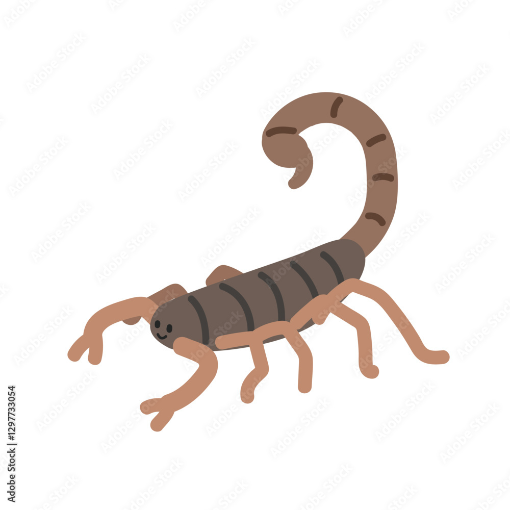

# Contexto

Para fines de obtener la mayor cantidad de imagenes se tomarán las especies de escorpiones que comparten género (Hetrometrus).
En estos enlaces se encuentran descripciones generales (por lo observado):
- "A review of the genus Heterometrus Ehrenberg, 1828, with descriptions of seven new species (Scorpiones, Scorpionidae): "https://mds.marshall.edu/euscorpius/vol2004/iss15/1/
- "Systematics and biogeography of the family Scorpionidae (Chelicerata: Scorpiones), with a discussion on phylogenetic methods": https://www.amnh.org/content/download/55200/865437/file/the-family-scorpionidae-latreille-1802-phylogeny-taxonomy-and-biogeography.-invertebrate-systematics-17-185-259.pdf

## Otras cosas interesantes
- https://mds.marshall.edu/euscorpius/
- https://sci-hub.mx/10.3161/00034541ANZ2016.66.3.011

# Indice
- [Heterometrus barberi]()
- [Heterometrus bengalensis](#heterometrus-bengalensis)
- [Heterometrus cimrami]()
- [Heterometrus cyaneus]()
- [Heterometrus fulvipes]()
- [Heterometrus gravimanus]()
- [Heterometrus indus]()
- [Heterometrus kanarensis]()
- [Heterometrus laoticus](#heterometrus-laoticus)
- [Heterometrus latimanus]()
- [Heterometrus liophysa]()
- [Heterometrus liurus]()
- [Heterometrus longimanus]()
- [Heterometrus mysorensis]()
- [Heterometrus nepalensis]()
- [Heterometrus petersii]()
- [Heterometrus polcki]()
- [Heterometrus scaber]()
- [Heterometrus sejnai]()
- [Heterometrus spinifes]()
- [Heterometrus swammerdami]()
- [Heterometrus tenagensis]()
- [Heterometrus thorelli]()
- [Heterometrus tibetanus]()
- [Heterometrus ubicki]()
- [Heterometrus wrouthoni]()
- [Heterometrus xanthopus]()
- [Heterometrus ]()
- [Heterometrus ]()
- [Heterometrus ]()
- [Heterometrus ]()
- [Heterometrus ]()
- [Heterometrus ]()

# Especies

## Heterometrus laoticus
- https://commons.wikimedia.org/wiki/Category:Heterometrus?uselang=vi

## Heterometrus bengalensis
- https://commons.wikimedia.org/wiki/Category:Heterometrus_bengalensis
- https://indiabiodiversity.org/group/malfrogs/observation/show/16743766